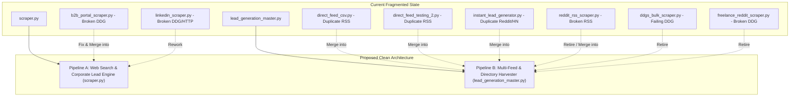

# Prioritized Recommendations & System Improvement Plan

**Project:** `test-demo`  
**Location:** `c:\xampp\htdocs\Yashvi-Practical\test-demo`  
**Audit Date:** October 12, 2026  

---

## 1. Top Five Critical Issues to Address First

| Priority | Issue Description | Affected Files & Lines | Impact | Recommended Solution |
|---|---|---|---|---|
| **#1 (Urgent)** | **Broken Import `from ddgs import DDGS`** | [`b2b_portal_scraper.py:4`](file:///c:/xampp/htdocs/Yashvi-Practical/test-demo/b2b_portal_scraper.py#L4), [`freelance_reddit_scraper.py:4`](file:///c:/xampp/htdocs/Yashvi-Practical/test-demo/freelance_reddit_scraper.py#L4), [`linkedin_scraper.py:8`](file:///c:/xampp/htdocs/Yashvi-Practical/test-demo/linkedin_scraper.py#L8) | **Fatal Crash:** 3 scripts crash on startup with `ModuleNotFoundError: No module named 'ddgs'`. | Change import statement to `from duckduckgo_search import DDGS`. Add `duckduckgo_search` to `requirements.txt`. |
| **#2 (Urgent)** | **Missing Dependency `feedparser`** | [`reddit_rss_scraper.py:2`](file:///c:/xampp/htdocs/Yashvi-Practical/test-demo/reddit_rss_scraper.py#L2) | **Fatal Crash:** Script crashes immediately on execution. | Either install `feedparser` via `pip install feedparser` and add to `requirements.txt`, or replace with standard library `xml.etree.ElementTree` (which is already proven in `direct_feed_csv.py`). |
| **#3 (High)** | **Flawed Hiring vs. Job-Seeker Filtering** | [`reddit_rss_scraper.py:75`](file:///c:/xampp/htdocs/Yashvi-Practical/test-demo/reddit_rss_scraper.py#L75) | **Data Corruption:** Scrapes freelancers seeking jobs (`[FOR HIRE]`) as if they were client hiring leads. | Add strict condition: `if "[for hire]" in title.lower(): continue` and require `"hiring" in title.lower()`. |
| **#4 (High)** | **Unfiltered Fallback Search & Weak Phone Regex** | [`b2b_portal_scraper.py:86-94`](file:///c:/xampp/htdocs/Yashvi-Practical/test-demo/b2b_portal_scraper.py#L86-L94), [`b2b_portal_scraper.py:54`](file:///c:/xampp/htdocs/Yashvi-Practical/test-demo/b2b_portal_scraper.py#L54) | **Data Corruption:** Generic fallback queries capture Wikipedia, Microsoft, and GeeksforGeeks, storing arbitrary digit strings (e.g. `1377063225`) as phone numbers. | Restrict fallback queries with domain constraints (`site:indiamart.com`) and apply normalized Indian phone validation from `scraper.py`. |
| **#5 (High)** | **Direct HTTP Requests Blocked by LinkedIn Anti-Bot** | [`linkedin_scraper.py:96-102`](file:///c:/xampp/htdocs/Yashvi-Practical/test-demo/linkedin_scraper.py#L96-L102) | **Total Scraper Failure:** LinkedIn blocks direct `requests.get()` with HTTP 999 or login redirect walls. | Do not use plain HTTP `requests` against LinkedIn. Use Playwright with session cookies or extract company websites from search snippets instead of visiting LinkedIn URLs directly. |

---

## 2. Redundancy & Architecture Consolidation Plan

Currently, the workspace contains **10 separate scripts** with significant overlap and duplication:



### Proposed Consolidated Pipeline:

1. **Pipeline 1 — Search Engine & Web Discovery Engine (`scraper.py`):**
   - Retain Google / Yahoo / Bing search fallback.
   - Retain deep crawling of `/contact` pages for email and phone extraction.
   - Retain Buyer Intent Detection & Scoring.
   - Add CLI arguments (`--location`, `--category`, `--max-results`) instead of hardcoding.

2. **Pipeline 2 — Multi-Feed & Local Directory Master Engine (`lead_generation_master.py`):**
   - Absorb Reddit RSS + JSON API feeds.
   - Absorb WeWorkRemotely and Remotive feeds.
   - Absorb Hacker News hiring posts.
   - Keep Playwright-based Justdial scraper with deep website contact enrichment.
   - Retire single-purpose redundant scripts (`direct_feed_csv.py`, `direct_feed_testing_2.py`, `reddit_rss_scraper.py`, `ddgs_bulk_scraper.py`).

---

## 3. Data Quality & Contact Extraction Enhancements

1. **Unify Contact Extraction:**
   - Standardize on `ContactExtractor` from [`lead_generation_master.py`](file:///c:/xampp/htdocs/Yashvi-Practical/test-demo/lead_generation_master.py) and `validate_and_normalize_indian_phone()` from [`scraper.py`](file:///c:/xampp/htdocs/Yashvi-Practical/test-demo/scraper.py).
   - This prevents false-positive phone numbers (such as image dimensions or random numbers) from being saved.

2. **Unified Storage Schema:**
   - Currently, each script writes to a different CSV with mismatched column names (`"Mobile Number"`, `"Extracted_Phones"`, `"Mobile"`, `"Phones"`).
   - Standardize on a single column structure:
     `[Business Name, Source, Category, City, Website URL, Email, Phone, Telegram, Intent, Lead Score, Scraped At]`

3. **Persistent Deduplication:**
   - Migrate deduplication logic from in-memory sets to a centralized SQLite database or shared master index to avoid re-scraping existing leads across different runs.

---

## 4. `requirements.txt` Updates

Update [`requirements.txt`](file:///c:/xampp/htdocs/Yashvi-Practical/test-demo/requirements.txt) to reflect all packages actively used across the project:

```text
requests>=2.31.0
beautifulsoup4>=4.12.0
pandas>=2.0.0
googlesearch-python>=1.2.4
duckduckgo-search>=8.0.0
playwright>=1.40.0
```

*(Run `playwright install chromium` after installation).*
