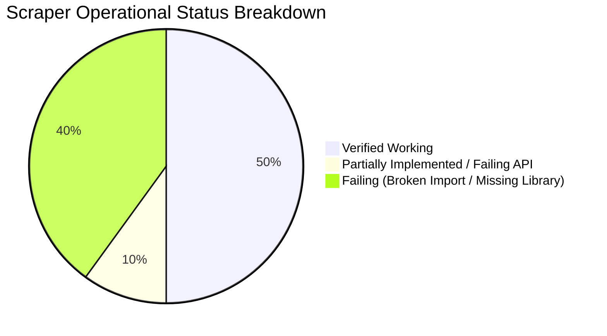

# Comprehensive Scraper Inventory & Component Audit

**Project:** `test-demo`  
**Location:** `c:\xampp\htdocs\Yashvi-Practical\test-demo`  
**Audit Date:** October 12, 2026  
**Auditor:** Antigravity AI Code Auditor  

---

## 1. Executive Summary

This inventory documents all scraping, crawling, RSS harvesting, API lead collection, and data extraction components identified in the current system. Every script was inspected for syntax, module dependencies, actual source accessibility, rate-limiting constraints, output formats, and runtime behavior.

- **Total Scraper Modules Identified:** 10
- **Verified Working & Operational:** 5
- **Partially Implemented / Failing via Rate Limits:** 1
- **Failing / Broken Imports or Missing Dependencies:** 4
- **Overlapping / Redundant Scripts:** 4 (Multiple RSS harvesters with near-identical logic)

---

## 2. Complete Scraper Inventory Table

| No. | Scraper Name | File Path | Data Source | Technology | Status | Main Purpose |
|---|---|---|---|---|---|---|
| 1 | **Public IT & Software Hiring Lead Scraper** | [`scraper.py`](file:///c:/xampp/htdocs/Yashvi-Practical/test-demo/scraper.py) | Google Search, Yahoo Search, Bing Search & Target Company Websites | Python, Requests, BeautifulSoup4, googlesearch-python, Pandas, Regex | **Implemented and verified working** | Discovers businesses actively searching to hire IT companies, filters directories/junk, deep-crawls `/contact` pages for emails and normalized Indian phone numbers, evaluates buyer intent, and scores leads. |
| 2 | **Multi-Source Master Lead Generation Engine** | [`lead_generation_master.py`](file:///c:/xampp/htdocs/Yashvi-Practical/test-demo/lead_generation_master.py) | Reddit RSS (`r/forhire`), WeWorkRemotely RSS, Justdial Ahmedabad (via Playwright) & Company Websites | Python, Playwright (Chromium sync), Requests, BeautifulSoup4, ElementTree, Regex | **Implemented and verified working** | Enterprise multi-source pipeline harvesting client hiring leads from Reddit & WWR RSS feeds, and local IT businesses from Justdial via headless browser automation with deep website enrichment. |
| 3 | **Reddit Direct RSS Lead Harvester** | [`direct_feed_csv.py`](file:///c:/xampp/htdocs/Yashvi-Practical/test-demo/direct_feed_csv.py) | Reddit RSS Feed (`/r/forhire/new/.rss`) | Python standard library (`urllib.request`, `xml.etree.ElementTree`, `re`, `csv`) | **Implemented and verified working** | Lightweight RSS reader polling Reddit `r/forhire` for posts with `[Hiring]` in the title, extracting emails, Telegram handles, and phone numbers via regex into CSV. |
| 4 | **Multi-Feed Remote Jobs & Client Harvester** | [`direct_feed_testing_2.py`](file:///c:/xampp/htdocs/Yashvi-Practical/test-demo/direct_feed_testing_2.py) | Reddit RSS (`r/forhire`), WeWorkRemotely RSS, Remotive RSS | Python standard library (`urllib.request`, `xml.etree.ElementTree`, `re`, `csv`) | **Implemented and verified working** | Multi-channel RSS aggregator parsing 3 feeds (Reddit, WeWorkRemotely, Remotive), filtering for hiring keywords and extracting contact info into a unified CSV. |
| 5 | **Instant Lead Generator (Reddit & HN API)** | [`instant_lead_generator.py`](file:///c:/xampp/htdocs/Yashvi-Practical/test-demo/instant_lead_generator.py) | Reddit Public JSON API (`/new.json`), Hacker News Algolia Search API | Python, Requests, Pandas, Regex, Datetime | **Implemented and verified working** | Direct REST API collector querying Reddit subreddits and HN Algolia API for recent hiring threads, extracting contacts, and deduplicating by URL in Pandas. |
| 6 | **DuckDuckGo 20-Query Dork Bulk Scraper** | [`ddgs_bulk_scraper.py`](file:///c:/xampp/htdocs/Yashvi-Practical/test-demo/ddgs_bulk_scraper.py) | DuckDuckGo Search (querying Reddit, Twitter/X, Upwork, HN, Dev.to, GitHub) | Python, `duckduckgo_search` (DDGS), `csv`, `time` | **Partially implemented / Failing** | Runs 20 automated Google Dorks through DuckDuckGo to collect hiring URLs. Code is syntactically valid, but outputs 0 results (`bulk_leads_output.csv` is 39 bytes) due to DuckDuckGo search throttle/block. Does not extract contacts. |
| 7 | **B2B Directory Footprint Scraper** | [`b2b_portal_scraper.py`](file:///c:/xampp/htdocs/Yashvi-Practical/test-demo/b2b_portal_scraper.py) | DuckDuckGo Search (querying IndiaMART, TradeIndia, ExportersIndia) & External URLs | Python, `ddgs` (broken import), Requests, BeautifulSoup4, Regex | **Failing or misconfigured** | Attempts to harvest B2B IT leads from trade portals. Fails on launch with `ModuleNotFoundError: No module named 'ddgs'`. Fallback search captures irrelevant sites (Wikipedia, Softonic, GeeksforGeeks) with invalid phone extractions. |
| 8 | **Multi-Platform Freelance Dork Scraper** | [`freelance_reddit_scraper.py`](file:///c:/xampp/htdocs/Yashvi-Practical/test-demo/freelance_reddit_scraper.py) | DuckDuckGo Search (querying Reddit, Freelancer, Upwork, Twitter) | Python, `ddgs` (broken import), Regex, `csv` | **Failing or misconfigured** | Queries DuckDuckGo for freelance project posts across 5 platforms and extracts email, Discord, and URLs. Fails to run due to broken import `from ddgs import DDGS`. |
| 9 | **LinkedIn B2B Company & Profile Scraper** | [`linkedin_scraper.py`](file:///c:/xampp/htdocs/Yashvi-Practical/test-demo/linkedin_scraper.py) | DuckDuckGo Search (`site:linkedin.com`), LinkedIn Web Pages, External Company Sites | Python, `ddgs` (broken import), Requests, BeautifulSoup4, Pandas, Regex | **Failing or misconfigured** | Searches LinkedIn profiles/companies via DDG and attempts direct HTTP scraping of LinkedIn pages. Fails due to broken import (`ddgs`) and direct requests to LinkedIn are blocked with HTTP 999 / login walls. |
| 10 | **Reddit Multi-Subreddit RSS Harvester** | [`reddit_rss_scraper.py`](file:///c:/xampp/htdocs/Yashvi-Practical/test-demo/reddit_rss_scraper.py) | Reddit RSS Feeds (`r/forhire`, `r/freelance_forhire`, `r/jobbit`) | Python, `feedparser` (missing dependency), Regex, HTML | **Failing or misconfigured** | Monitors three subreddits via RSS for hiring posts. Fails with `ModuleNotFoundError: No module named 'feedparser'`. Filtering logic also mistakenly captures `[FOR HIRE]` job-seeker posts as client leads. |

---

## 3. Status Breakdown

- **Verified Working (5):**
  1. [`scraper.py`](file:///c:/xampp/htdocs/Yashvi-Practical/test-demo/scraper.py)
  2. [`lead_generation_master.py`](file:///c:/xampp/htdocs/Yashvi-Practical/test-demo/lead_generation_master.py)
  3. [`direct_feed_csv.py`](file:///c:/xampp/htdocs/Yashvi-Practical/test-demo/direct_feed_csv.py)
  4. [`direct_feed_testing_2.py`](file:///c:/xampp/htdocs/Yashvi-Practical/test-demo/direct_feed_testing_2.py)
  5. [`instant_lead_generator.py`](file:///c:/xampp/htdocs/Yashvi-Practical/test-demo/instant_lead_generator.py)

- **Partially Implemented / Rate Limited (1):**
  1. [`ddgs_bulk_scraper.py`](file:///c:/xampp/htdocs/Yashvi-Practical/test-demo/ddgs_bulk_scraper.py)

- **Failing or Misconfigured (4):**
  1. [`b2b_portal_scraper.py`](file:///c:/xampp/htdocs/Yashvi-Practical/test-demo/b2b_portal_scraper.py) (`ModuleNotFoundError: No module named 'ddgs'`, flawed fallback queries)
  2. [`freelance_reddit_scraper.py`](file:///c:/xampp/htdocs/Yashvi-Practical/test-demo/freelance_reddit_scraper.py) (`ModuleNotFoundError: No module named 'ddgs'`)
  3. [`linkedin_scraper.py`](file:///c:/xampp/htdocs/Yashvi-Practical/test-demo/linkedin_scraper.py) (`ModuleNotFoundError: No module named 'ddgs'`, blocked by LinkedIn anti-bot)
  4. [`reddit_rss_scraper.py`](file:///c:/xampp/htdocs/Yashvi-Practical/test-demo/reddit_rss_scraper.py) (`ModuleNotFoundError: No module named 'feedparser'`, flawed filter logic)

---

## 4. Associated Output Data Artifacts (CSVs)

| Output File Path | Created By Script | Rows / Leads | Notes on Stored Content |
|---|---|---|---|
| [`leads.csv`](file:///c:/xampp/htdocs/Yashvi-Practical/test-demo/leads.csv) | `scraper.py` | 6 qualified leads | High-quality business websites with verified emails, phones, intent scores >= 4. |
| [`rejected_leads.csv`](file:///c:/xampp/htdocs/Yashvi-Practical/test-demo/rejected_leads.csv) | `scraper.py` | 2 rejected sites | Candidate URLs rejected with specific criteria (`Score < 4`, `Blog/Article`). |
| [`master_leads.csv`](file:///c:/xampp/htdocs/Yashvi-Practical/test-demo/master_leads.csv) | `lead_generation_master.py` | 12 leads | Aggregated leads from Reddit client posts and WeWorkRemotely jobs with deep contact enrichment. |
| [`leads_perfect.csv`](file:///c:/xampp/htdocs/Yashvi-Practical/test-demo/leads_perfect.csv) | `direct_feed_csv.py` | 6 leads | Reddit `r/forhire` client hiring posts with email, mobile, telegram columns. |
| [`all_leads_clean.csv`](file:///c:/xampp/htdocs/Yashvi-Practical/test-demo/all_leads_clean.csv) | `direct_feed_testing_2.py` | 78 leads | Combined feed leads from Reddit and WeWorkRemotely. |
| [`instant_leads_master.csv`](file:///c:/xampp/htdocs/Yashvi-Practical/test-demo/instant_leads_master.csv) | `instant_lead_generator.py` | 16 leads | Hacker News stories and Reddit posts collected via REST APIs. |
| [`b2b_portals_leads.csv`](file:///c:/xampp/htdocs/Yashvi-Practical/test-demo/b2b_portals_leads.csv) | `b2b_portal_scraper.py` | 23 records | Contaminated with Wikipedia, Microsoft, GeeksforGeeks articles due to fallback logic. |
| [`freelance_reddit_leads_v2.csv`](file:///c:/xampp/htdocs/Yashvi-Practical/test-demo/freelance_reddit_leads_v2.csv) | `freelance_reddit_scraper.py` | 27 records | Past run outputs; mostly Reddit thread URLs without direct contacts in snippets. |
| [`linkedin_leads.csv`](file:///c:/xampp/htdocs/Yashvi-Practical/test-demo/linkedin_leads.csv) | `linkedin_scraper.py` | 2 records | Past run outputs; Dutch and Canadian profile links with missing or external contacts. |
| [`reddit_rss_leads.csv`](file:///c:/xampp/htdocs/Yashvi-Practical/test-demo/reddit_rss_leads.csv) | `reddit_rss_scraper.py` | 21 records | Contaminated with `[FOR HIRE]` posts (freelancers seeking work, not clients hiring). |
| [`bulk_leads_output.csv`](file:///c:/xampp/htdocs/Yashvi-Practical/test-demo/bulk_leads_output.csv) | `ddgs_bulk_scraper.py` | 0 records | File header only (39 bytes). Search engine returned empty or timed out. |
